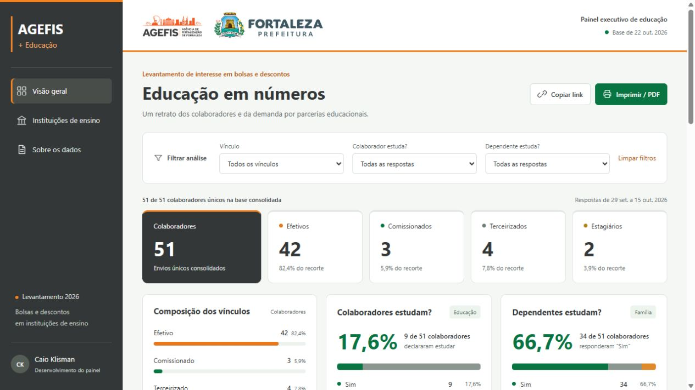

# AGEFIS + Educação

Dashboard executivo de indicadores educacionais agregados, desenvolvido por **Caio Klisman** com apoio do Codex.



## Problema e solução

O projeto transforma respostas de um levantamento em uma visão organizada para apoiar a análise de interesse em bolsas e descontos educacionais no contexto da AGEFIS, em Fortaleza. Apresenta totais, distribuições e instituições citadas com filtros e notas sobre o significado dos dados.

## Recursos

- Filtros por vínculo e situação de estudo do colaborador e do dependente.
- Gráficos com rótulos textuais e ranking de instituições.
- Resumo em CSV e impressão/PDF.
- Layout responsivo e informações de metodologia.

**Tecnologias:** JavaScript, HTML, CSS, JSON e Node.js apenas para a prévia e os testes. Não requer bibliotecas externas.

## Executar

Requisito: **Node.js 24 ou superior**. Não é necessário instalar dependências.

```sh
git clone https://github.com/CKlisman/agefis-educacao.git
cd agefis-educacao
npm test
npm start
```

Abra o endereço local exibido no terminal. A porta é escolhida automaticamente. O código executável está em `dist/`, que neste projeto contém os arquivos estáticos legíveis, sem necessidade de build.

## Dados e limites

A base publicada contém somente agregados já destinados à divulgação: 54 envios consolidados em 51 pessoas, na fotografia de 22/10/2026. Não inclui nomes, e-mails, telefones ou a planilha original.

Instituições atuais e desejadas podem aparecer no mesmo campo da fonte. Os totais não representam necessariamente matrículas nem quantidade de dependentes. A atualização da fonte exige nova consolidação; não há sincronização automática.

Leia [a metodologia completa](docs/METODOLOGIA.md). As marcas institucionais identificam o contexto do trabalho e permanecem pertencentes aos seus titulares.

## Organização

| Caminho | Conteúdo |
| --- | --- |
| `dist/index.html` | Estrutura do painel |
| `dist/app.mjs` | Filtros, gráficos e exportação |
| `dist/model.mjs` | Seleção, contagem e ranking |
| `dist/data.json` | Dados agregados |
| `verify.mjs` | Conferência dos totais, filtros e ausência de campos pessoais |

## Decisões e aprendizados

A separação entre modelo e interface permite conferir a consistência dos filtros sem abrir o navegador. A consolidação evita contar envios duplicados, e as notas de interpretação ajudam a não atribuir à fonte informações que ela não contém.

**Validação local em 03/11/2026:** conferência dos totais, 80 combinações de filtros, ranking, verificação dos campos públicos e sintaxe JavaScript aprovadas. A rotina é executada no GitHub Actions; consulte a aba Actions para o estado remoto.

[Portfólio de Caio Klisman](https://github.com/CKlisman) · [Escopo da publicação](docs/ESCOPO.md)
