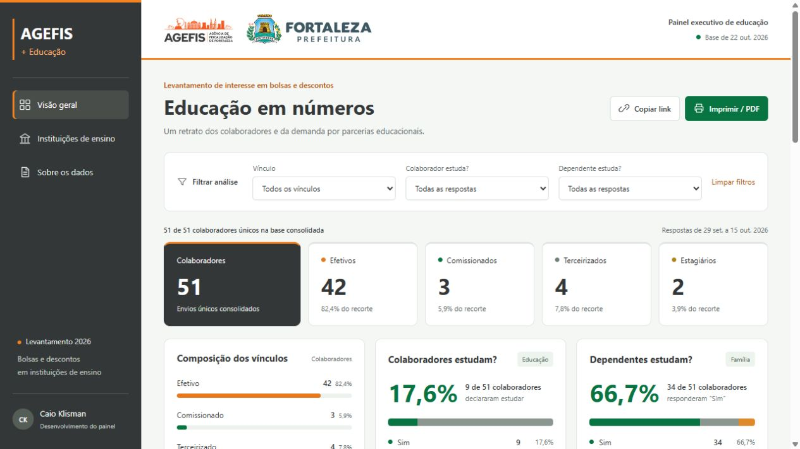
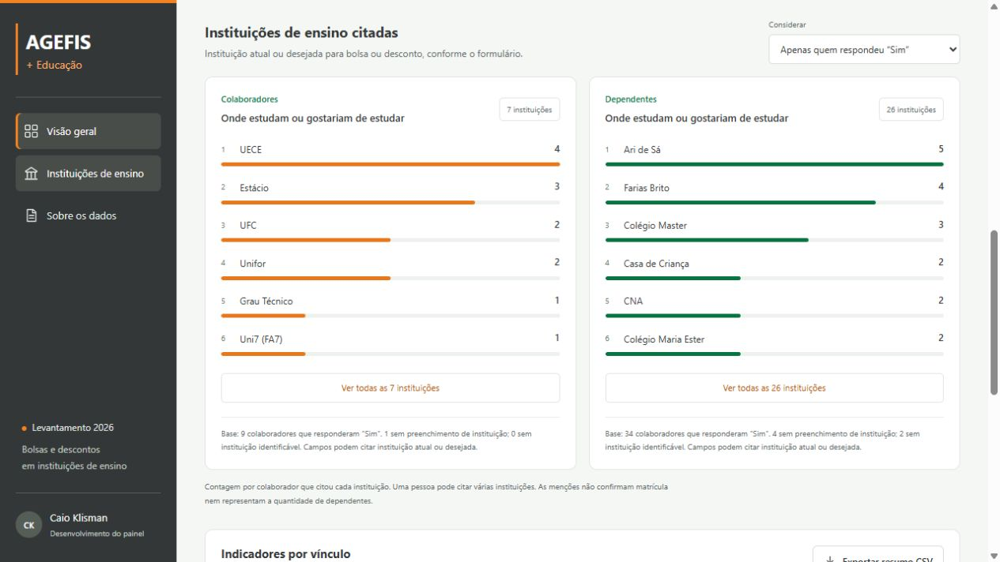
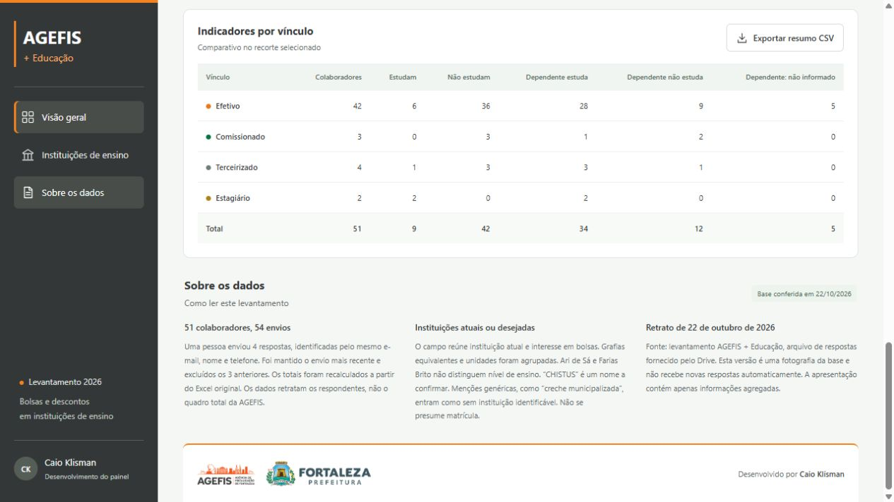
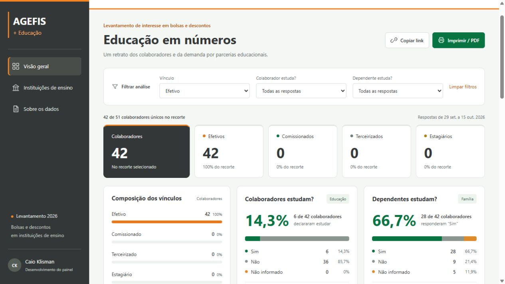

# Telas reais do projeto

Capturas feitas na aplicação publicada em 03/11/2026. As imagens registram a interface original em uso; não são telas reconstruídas nem imagens geradas.

Capturas do dashboard publicado, com dados agregados. A captura de filtros mostra o recorte Efetivo aplicado à base existente.

## Visão geral do dashboard publicado

## Ranking de instituições do dashboard publicado

## Metodologia e indicadores por vínculo — dashboard publicado

## Filtro de efetivos aplicado na base real agregada

